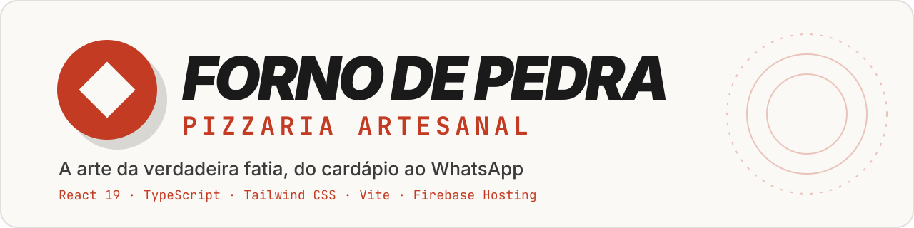
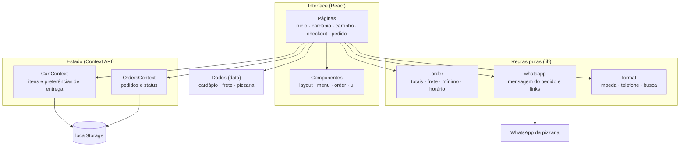
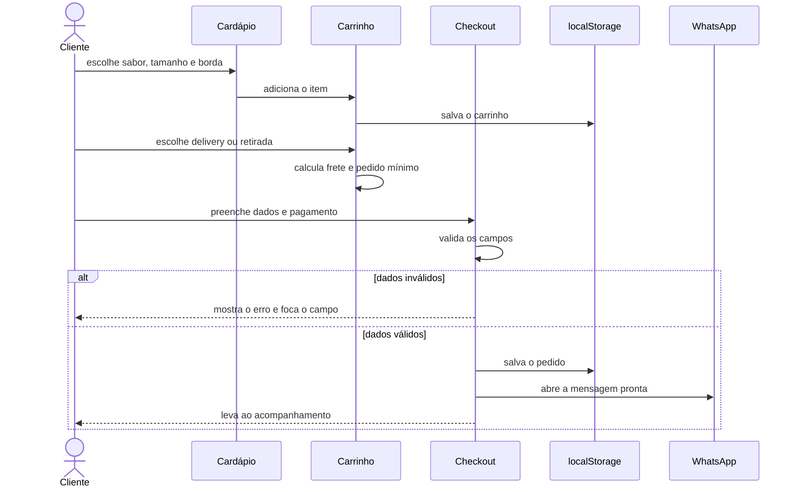

<div align="center">



# ♨ Forno de Pedra
### A arte da verdadeira fatia, do cardápio ao WhatsApp

**Modelo comercial de site para pizzarias e delivery, em React e TypeScript.**
Cardápio digital com busca, pizza personalizada, frete por bairro, pedido mínimo e checkout validado,<br/>
com o pedido pronto no WhatsApp da loja e um acompanhamento simulado para demonstração.

[](https://pizzaria-forno-de-pedra.web.app/)


</div>

---

## 👨‍💻 Autor

<table>
  <tr>
    <td width="62%">

Eu sou o **Gustavo Osterno Thé**, e o **Forno de Pedra** é um dos projetos do meu portfólio público e do meu catálogo de serviços. Idealizei, desenvolvi e mantenho este repositório.

Muitas pizzarias recebem pedidos pelo WhatsApp em mensagens soltas, e cada venda vira uma troca de perguntas sobre sabor, tamanho, endereço, taxa e troco. Este modelo resolve isso antes da conversa começar: o cliente monta o pedido no site, e a loja recebe tudo calculado e organizado em uma única mensagem.

    </td>
    <td width="38%">

| | |
|---|---|
| 🌐 Site | [site-gustavothe-dev.web.app](https://site-gustavothe-dev.web.app/) |
| 💼 LinkedIn | [gustavoosterno](https://www.linkedin.com/in/gustavoosterno/) |
| 🐙 GitHub | [@GustavoThe01](https://github.com/GustavoThe01) |
| 📸 Instagram | [@gustavo.osterno](https://www.instagram.com/gustavo.osterno) |

    </td>
  </tr>
</table>

> ⚠️ **Website demonstrativo:** a pizzaria, os pedidos, o telefone e os depoimentos são fictícios. Nenhuma pizza é produzida ou entregue, então não informe dados reais ao testar. Veja a demonstração em **[pizzaria-forno-de-pedra.web.app](https://pizzaria-forno-de-pedra.web.app/)**.

---

## 📑 Sumário

- [Em números](#-em-números)
- [A origem do nome](#-a-origem-do-nome)
- [O que o site faz](#-o-que-o-site-faz)
- [Rotas e telas](#-rotas-e-telas)
- [Arquitetura](#️-arquitetura)
- [Como um pedido chega à pizzaria](#-como-um-pedido-chega-à-pizzaria)
- [Competências demonstradas](#-competências-demonstradas)
- [Metodologias e decisões](#-metodologias-e-decisões)
- [Como adaptar para um cliente](#-como-adaptar-para-um-cliente)
- [Roadmap](#️-roadmap)
- [Como rodar](#-como-rodar)
- [Testes](#-testes)
- [Estrutura do projeto](#-estrutura-do-projeto)
- [O que ainda falta](#-o-que-ainda-falta)
- [Projetos relacionados](#-projetos-relacionados)

---

## 📊 Em números

<div align="center">

| 🍕 Cardápio | 🛵 Pedido | 📱 Interface | ⚡ Build |
|:---:|:---:|:---:|:---:|
| **21** itens em **4** categorias | **7** bairros com taxa própria | **8** rotas | **103 KB** de JS com gzip |
| **4** tamanhos de pizza | delivery ou **retirada** | testado de **320** a **1366 px** | foto otimizada de **8,7 MB** para **140 KB** |
| **4** opções de borda | **4** formas de pagamento | aviso de demonstração em **3** pontos | TypeScript **estrito** |

</div>

---

## ♨ A origem do nome

> *Uma boa pizza começa muito antes do forno, mas é na pedra que ela ganha caráter.*

O **forno de pedra** é o símbolo da pizzaria artesanal: calor intenso, borda dourada e massa assada direto na pedra. O nome dá identidade à marca fictícia deste modelo, criada para mostrar como o site fica com história, cardápio e personalidade próprios.

---

## ✨ O que o site faz

| Para quem | Recurso |
|---|---|
| 🍕 **Cliente** | Cardápio com filtro por categoria e busca que ignora acentos |
| 🍕 **Cliente** | Pizza personalizada com tamanho, borda e quantidade |
| 🍕 **Cliente** | Carrinho salvo no navegador, com frete por bairro e pedido mínimo para delivery |
| 🍕 **Cliente** | Checkout com máscara de telefone, validação e cálculo de troco |
| 🍕 **Cliente** | Pedido formatado e enviado para o WhatsApp da pizzaria |
| 🍕 **Cliente** | Acompanhamento do pedido, com etapas próprias para delivery e retirada |
| 🏪 **Dono da pizzaria** | Dados do negócio, cardápio e frete centralizados em arquivos simples |
| 🧪 **Quem avalia o modelo** | Simulador de etapas, sem precisar de backend |

---

## 🌐 Rotas e telas

| Rota | Tela | Destaque |
|---|---|---|
| `/` | Início | Apresentação, diferenciais, mais pedidos e depoimentos ilustrativos |
| `/cardapio` | Cardápio | Filtros, busca e personalização do item |
| `/carrinho` | Carrinho | Quantidades, tipo de entrega, frete e pedido mínimo |
| `/checkout` | Finalização | Dados do cliente, pagamento e envio pelo WhatsApp |
| `/pedido/:id` | Acompanhamento | Progresso do pedido e simulador de etapas |
| `/sobre` | Nossa história | Marca, processo e pilares da pizzaria |
| `/contato` | Contato | Endereço, horário, WhatsApp e Google Maps |
| `*` | Página 404 | Caminho de volta para o cardápio |

---

## 🏛️ Arquitetura



---

## 🔄 Como um pedido chega à pizzaria



---

## 🧠 Competências demonstradas

| Área | Conceitos |
|---|---|
| **Front-end** | React 19, React Router, Context API, componentes reutilizáveis e `<dialog>` nativo |
| **TypeScript** | Modo estrito e tipos do domínio para cardápio, carrinho e pedido |
| **Interface** | Tailwind CSS 4, tema próprio e layout responsivo de 320 a 1366 px |
| **Regras de negócio** | Frete, pedido mínimo, troco, junção de itens iguais e horário por fuso |
| **Acessibilidade** | Foco no primeiro erro, atributos ARIA, navegação por teclado e movimento reduzido |
| **Desempenho** | Imagem em WebP, carregamento adiado e cache por tipo de arquivo |
| **Infra** | Firebase Hosting, headers de segurança e roteamento de SPA |

---

## 🧭 Metodologias e decisões

- **Sem backend, de propósito**: por ser uma vitrine, o site não coleta dados na nuvem. Pedidos ficam no navegador do visitante, o que evita guardar dados pessoais de quem só está testando.
- **WhatsApp como canal de venda**: o pedido chega onde muitas pizzarias já atendem, sem exigir um painel novo.
- **Regras separadas da interface**: cálculos e formatações ficam em `lib/`, prontos para receber testes unitários.
- **Conteúdo separado do código**: cardápio, frete e dados do negócio ficam em `data/`, o que acelera a adaptação para cada cliente.
- **Transparência comercial**: o aviso de demonstração aparece na primeira visita, no rodapé e no checkout, e os depoimentos são identificados como ilustrativos.
- **Falha sem quebrar a tela**: dados locais corrompidos são ignorados, e imagens externas indisponíveis dão lugar a uma imagem padrão.

O relatório técnico completo está em **[docs/AUDITORIA.md](docs/AUDITORIA.md)**.

---

## 🎨 Como adaptar para um cliente

| Quero mudar | Arquivo |
|---|---|
| Nome, WhatsApp, endereço e horários | `src/data/pizzaria.ts` |
| Sabores, preços, bordas e tamanhos | `src/data/menu.ts` |
| Bairros, taxas e pedido mínimo | `src/data/delivery.ts` |
| Cores e fontes | `src/styles/index.css` |
| Depoimentos e história | `src/pages/Home.tsx` e `src/pages/Sobre.tsx` |

> 📌 As fotos do cardápio são links externos usados apenas na demonstração. Em um projeto comercial, use fotos próprias ou licenciadas.

---

## 🗺️ Roadmap

| Fase | Tema | Status | Progresso |
|---|---|:---:|---|
| 1 | Cardápio, carrinho, checkout e envio pelo WhatsApp | no ar | 🟩🟩🟩🟩🟩 |
| 2 | Auditoria técnica, responsividade e reorganização do código | no ar | 🟩🟩🟩🟩🟩 |
| 3 | Testes automatizados, CI e fotos licenciadas | planejado | ⬜⬜⬜⬜⬜ |
| 4 | Backend, login e painel de pedidos para a pizzaria | planejado | ⬜⬜⬜⬜⬜ |

---

## 🚀 Como rodar

**Pré-requisito:** [Node.js 20+](https://nodejs.org/).

```bash
git clone https://github.com/GustavoThe01/pizzaria-forno-de-pedra.git
```

```bash
cd pizzaria-forno-de-pedra
```

```bash
npm ci
```

```bash
npm run dev
```

Acesse `http://localhost:3000`. Nenhuma variável de ambiente é necessária.

| Comando | O que faz |
|---|---|
| `npm run dev` | Inicia o servidor de desenvolvimento |
| `npm run typecheck` | Verifica os tipos |
| `npm run build` | Verifica os tipos e gera a versão em `dist/` |
| `npm run preview` | Serve localmente a versão gerada |
| `npm run deploy` | Gera a versão e publica no Firebase Hosting |

> ⚠️ O link de acompanhamento só funciona no navegador em que o pedido foi criado, porque não há backend nesta versão.

---

## 🧪 Testes

Ainda não há testes automatizados neste repositório. O fluxo de compra e a responsividade foram verificados manualmente no navegador. O plano:

| Tipo | Ferramenta | Situação |
|---|---|---|
| Unitários (`lib/order`, `lib/format`, `lib/whatsapp`) | Vitest | ⏳ Planejado |
| Componentes (personalização e checkout) | Testing Library | ⏳ Planejado |
| Fluxo de compra de ponta a ponta | Playwright | ⏳ Planejado |

---

## 📁 Estrutura do projeto

```
pizzaria-forno-de-pedra/
├── public/
│   ├── favicon.svg
│   └── images/                # ✅ imagens locais otimizadas
├── src/
│   ├── components/
│   │   ├── layout/            # ✅ cabeçalho, rodapé e aviso de portfólio
│   │   ├── menu/              # ✅ cartão do item e personalização
│   │   ├── order/             # ✅ itens, totais e progresso do pedido
│   │   └── ui/                # ✅ componentes genéricos
│   ├── context/               # ✅ carrinho e pedidos
│   ├── data/                  # ✅ cardápio, frete e dados do negócio
│   ├── lib/                   # ✅ regras puras e integrações
│   ├── pages/                 # ✅ uma página por rota
│   ├── styles/                # ✅ tema e classes compartilhadas
│   ├── types/                 # ✅ tipos do domínio
│   ├── App.tsx                # ✅ provedores e rotas
│   └── main.tsx
├── docs/
│   ├── assets/                # ✅ banner
│   └── AUDITORIA.md           # ✅ relatório técnico
├── firebase.json              # ✅ hospedagem, cache e headers
├── index.html
└── vite.config.ts
```

---

## 🧩 O que ainda falta

Mantenho aqui um checklist vivo do que ainda vou incrementar neste repositório.

**Projeto**
- [x] Cardápio, personalização, carrinho e frete por bairro
- [x] Checkout validado e pedido pelo WhatsApp
- [x] Acompanhamento simulado para delivery e retirada
- [x] Layout responsivo e aviso de demonstração
- [ ] Testes automatizados e GitHub Actions
- [ ] Substituir as fotos externas por imagens próprias ou licenciadas
- [ ] Backend com login e painel de pedidos para uso real
- [ ] Política de privacidade para clientes reais (LGPD)

**README**
- [ ] Prints das principais telas, no celular e no desktop
- [ ] Métricas de desempenho (Lighthouse)
- [ ] Definir e adicionar uma licença (`LICENSE`)

---

## 🔗 Projetos relacionados

| Projeto | Stack | Relação |
|---|---|---|
| 🌐 [Site do Gustavo](https://site-gustavothe-dev.web.app/) | React + Firebase | Onde estão os outros sites que desenvolvi |
| ☀ [Ceará Horizonte](https://github.com/GustavoThe01/ceara-horizonte-viagens) | Express + Firebase | Outro site para pequeno negócio, em produção |
| ✦ [Bifrost](https://github.com/GustavoThe01/bifrost-orders) | ASP.NET Core | **O domínio de pedidos no back-end** |
| ◈ [FlowDash360](https://github.com/GustavoThe01/flowdash360-beta) | React | Outro produto pensado para pequenos negócios |
| ♨ **Forno de Pedra** | React 19 | *você está aqui* |

<div align="center">

<sub>Forno aceso por mim, fatia por fatia · <a href="https://github.com/GustavoThe01">Gustavo Osterno Thé</a></sub>

</div>
